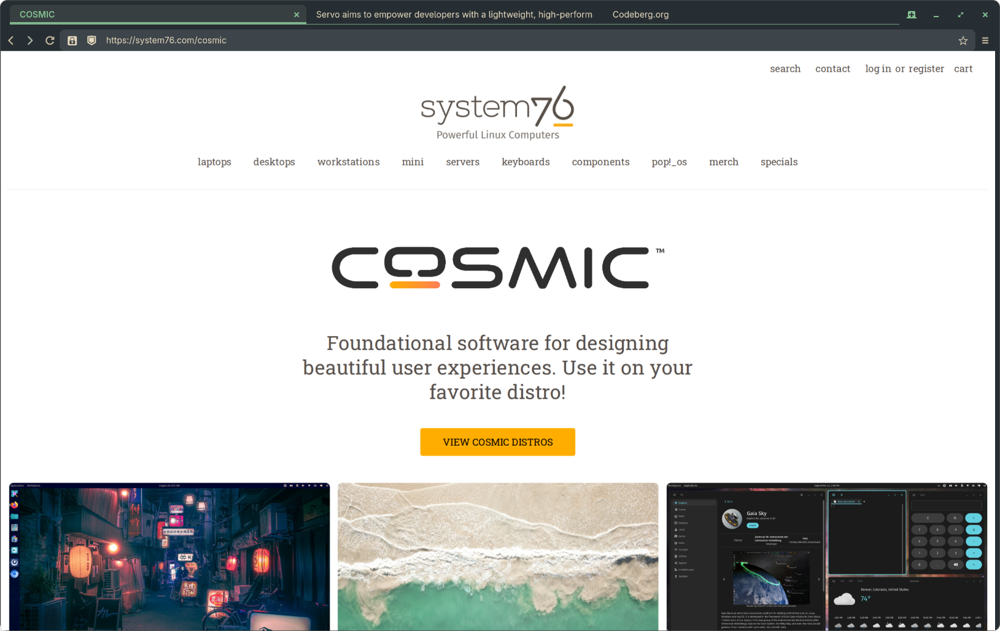

<p align="center">
  
</p>

<h1 align="center">Astrolabe</h1>

A web browser for the [COSMIC Desktop Environment](https://github.com/pop-os/cosmic-epoch), built
on the [Servo](https://servo.org/) web engine. Servo is the engine; Astrolabe is the instrument
you navigate by.

> **Note:** This project has no official connection to [System76](https://system76.com/) or the
> COSMIC Desktop Environment. It was originally called `cosmic-web` (and its engine widget
> `cosmic-webview`) out of lazy naming, nothing more, and was renamed to make that clear.
>
> This is a personal, experimental project built for fun — to kick the tyres on Servo as an
> embeddable engine, and to see how far AI-assisted development can carry a moderately complex
> Rust codebase. It is not intended for real use and will most likely never be.



## Overview

A web browser built on the [libcosmic](https://github.com/pop-os/libcosmic) UI toolkit (iced +
wgpu) with [Servo](https://servo.org/) as the rendering engine, via the companion
[astrolabe-webview](https://github.com/snaggen/astrolabe-webview) library. The browser is a single
binary that runs on Linux with X11 or Wayland.

## Features

- Multi-tab browsing with Ctrl+Tab/Ctrl+W
- Address bar with security indicator, zoom control, cookie-protection override, and site permissions
- Awesomebar with history and bookmark suggestions, plus live search-engine completions
- History drawer with filtering and sort
- Bookmarks drawer with filtering
- New Tab page with most-visited and pinned shortcuts, configurable grid size
- Firefox-compatible keyboard shortcuts (Ctrl+L, Ctrl+T, Ctrl+W, Ctrl+F, F3, F5, …)
- Find in page (Ctrl+F) with match counter, wrap and case-sensitive toggles
- Tracker and ad blocking via filter lists (uBlock-compatible)
- Per-site and global cookie-protection levels
- Site permission management (storage, camera/mic)
- Web font configuration (serif, sans-serif, monospace, size)
- Clear browsing data (cookies, site storage, history)
- Remote developer tools via Servo's Firefox Remote Debugging Protocol (optional)
- Persistent cookies and session data across restarts
- HTML5 media playback via GStreamer
- Kinetic (momentum) scrolling on touchpads
- HiDPI support

## Build and run

```bash
# Requires: Rust stable, wgpu-capable GPU driver, GStreamer dev libs
cargo build

# Run
cargo run

# Software rendering (headless / CI)
LIBGL_ALWAYS_SOFTWARE=1 cargo run
```

## Command line

```
astrolabe [OPTIONS] [URL]

      --profile-dir <DIR>     Cookies, history and other profile data
      --userscripts <DIR>     Directory to read *.js user scripts from
      --devtools-port <PORT>  Run the devtools server on PORT for this session
```

Everything else is configured in the browser's settings.

Install to `~/.local` (creates desktop entry and icon):

```bash
just install
```
